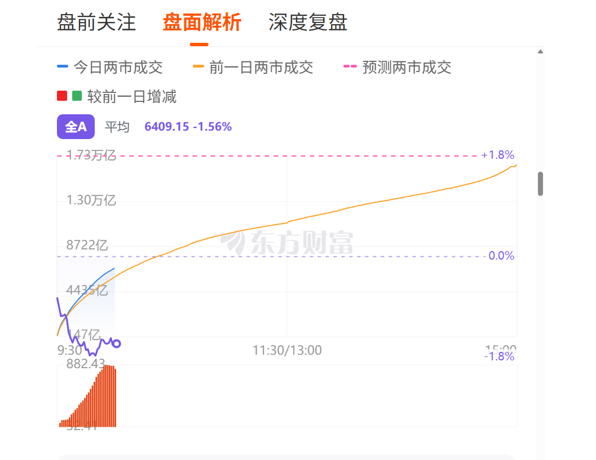

# 东方财富盘面增强：成交额对比与指数分时

这是一个 Tampermonkey（油猴）用户脚本，在东方财富“牛熊风向标”中叠加全A和平均股价分时，辅助观察实时成交额变化。

目标页面：<https://emrnweb.eastmoney.com/nxfxb/home>

## 功能

- 在原成交额图内叠加指数分时线，不创建独立图表；
- 支持东方财富全A（沪深京）和 A 股平均股价；【本来想用全A等权，但没找到】
- 通过图表上方紧凑工具栏切换“全A / 平均”，不会遮挡曲线；
- 使用独立的涨跌幅右轴，0% 始终位于中线；
- 工具栏显示最新点位和涨跌幅，鼠标悬停时显示所指分钟的数据；
- 未收盘时按真实分钟位置绘制，不会提前拉伸到 15:00；
- 页面异步渲染或重新创建图表后自动挂载；
- 原图的成交额曲线、增减柱和提示框保持可用。

颜色说明：紫色表示全A，青绿色表示平均股价。

## 安装

1. 在浏览器中安装 Tampermonkey。
2. 打开 [`main.user.js`](main.user.js)，点击 **Raw**，通常会直接拉起油猴安装页面；也可以复制完整内容手动安装。
3. 在 Tampermonkey 中选择“添加新脚本”，用复制的内容替换编辑器默认内容并保存。
4. 访问目标页面，向下滚动到“成交分析”。
5. 在成交额图上方选择“全A”或“平均”。

更新脚本时，再次打开最新版 `main.user.js` 的 Raw 链接安装，或者复制代码覆盖油猴中的旧版本即可。版本号位于脚本头部的 `@version`。

## 数据口径

| 按钮 | 指数 | `secid` | 说明 |
| --- | --- | --- | --- |
| 全A | 东方财富全A（沪深京） | `47.800004` | 不是等权指数 |
| 平均 | A股平均股价 | `47.800005` | 使用平均股价指数分时 |

脚本使用东方财富公开的 `trends2/get` 分时接口：

- 主接口：`https://push2his.eastmoney.com/api/qt/stock/trends2/get`
- 备用接口：`https://push2.eastmoney.com/api/qt/stock/trends2/get`
- 备用接口：`https://push2delay.eastmoney.com/api/qt/stock/trends2/get`

请求按当前按钮传入相应 `secid`，并设置 `ndays=1`。分钟记录读取 `f51`（时间）和 `f53`（点位），通过返回的昨收计算涨跌幅。

## 刷新规则

- 首次尚未取得数据：每 15 秒重试；
- 交易时段：每 30 秒刷新当前选中的指数；
- 午休、收盘后和周末：每 10 分钟刷新；
- 页面位于后台：跳过到期请求；
- 页面重新回到前台：立即刷新。

交易活跃窗口使用北京时间 `09:25～11:35` 和 `12:55～15:05`。目前只判断工作日，没有接入交易所节假日日历。

## 项目结构

- [`main.user.js`](main.user.js)：可通过 GitHub Raw 安装或复制到 Tampermonkey 的完整脚本；
- [`README.md`](README.md)：功能、安装、数据口径和使用说明；
- [`代码逻辑说明.md`](代码逻辑说明.md)：请求、时间映射、Canvas 绘图、切换、悬停和自动挂载的实现说明；
- `效果图.png`：使用的运行效果截图。

脚本只读取行情数据，不读取东方财富账号信息，不提交表单，也不调用交易接口。
